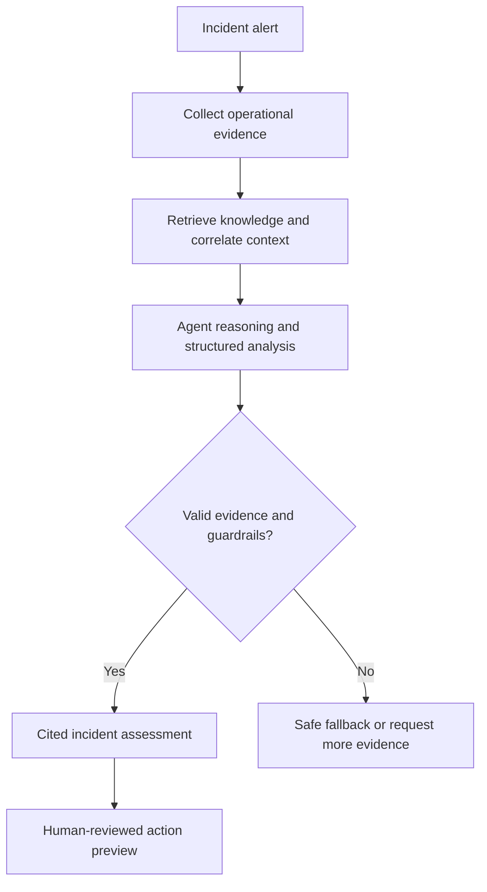

# Hi, I'm Re'em Mor 👋

### Generative AI Engineer @ Amdocs | Building Agentic AI Systems & Enterprise AI Solutions | Software Engineer

 

---

## 👨‍💻 From production incidents to enterprise AI

I'm a **Generative AI Engineer at Amdocs (amaiz / Cognitive Core)**, working on a **multi-agent AI platform for enterprise telecom billing and customer care**. My work connects **LLM orchestration and MCP integrations** with backend APIs, Python validation, business rules, and automated test scenarios across critical customer and billing entities.

Before AI engineering, I worked in **SRE, DevOps, and production operations at Evoke (888 Holdings)**. Being close to real incidents shaped how I build software: reliability cannot be added after the demo.

> **My engineering bias:** A model can propose. The system must verify. The operator stays in control.

**B.Sc. Computer Science**, The Open University of Israel (GPA 91).

## 🚀 Featured: [PETER PAN](https://github.com/reem-mor/peter-pan)

**Predictive · Agentic · Navigator**  
*An incident-intelligence platform for SRE, DevOps, and production operations.*

Monitoring data is fragmented across alerts, logs, deployments, service context, and runbooks. **PETER PAN** is designed to bring that evidence together into a structured, explainable incident story with suggested investigative steps and explicit human review.

**What I focused on building**

- **Agent systems:** Python, FastAPI, n8n orchestration, bounded LangGraph execution, and retrieval over operational knowledge.
- **Evidence over hallucination:** source-backed analysis, deterministic input/output guardrails, evaluation, and safe fallback behavior.
- **Production-minded controls:** read-only defaults, human approval for potentially mutating actions, observability, and usage visibility.

<b>🧭 See the incident flow and architecture decisions</b>

**Design decisions:** deterministic safety policies override LLM-generated claims; incident conclusions require traceable evidence; risky actions are never automatically executed by the model. The repository explicitly separates existing functionality from roadmap targets.

### The work behind PETER PAN

[PITER AiOps](https://github.com/reem-mor/piter-aiops) was its earlier incident-triage foundation, integrating an AWS Bedrock Agent, runbook RAG, four Lambda action groups, and escalation previews. PETER PAN expands the product direction into a broader incident-intelligence architecture.

## 🧩 Other selected engineering projects

**🔎 [HINDSIGHT - Document Intelligence](https://github.com/reem-mor/hindsight)**  
Processes cybersecurity documents with **Gemini, n8n, and FastAPI**. Deterministic backend rules handle severity, data sensitivity, and routing rather than trusting free-form model output.

**🤖 [Course Assistant Bot - Agentic Workflow Automation](https://github.com/reem-mor/course-assistant-bot)**  
Bilingual Telegram assistant with **async Python, LangGraph routing, SQLAlchemy/Alembic, Docker, and automated tests**, integrating scheduling, learning content, and administrative workflows.

<b>📚 More code: early RAG projects, AI experiments and DevOps practice</b>

- [AI Engineering Portfolio](https://github.com/reem-mor/ai-engineering-portfolio) - experiments and coursework that grew into standalone projects.
- [PITER AiOps](https://github.com/reem-mor/piter-aiops) - the earlier incident-triage product.

## 🛠️ Tools I use to build and operate systems

 

**AI engineering:** Agentic AI · MCP · RAG · LangGraph · LangChain · AWS Bedrock · n8n · LLM evaluations · guardrails  
**Software engineering:** Python · Java · TypeScript · FastAPI · REST APIs · SQL · pytest · backend integrations  
**Cloud & reliability:** AWS · Docker · Kubernetes · Terraform · CI/CD · Grafana · incident response

<b>🎓 Education and additional training</b>

- **B.Sc. Computer Science**, The Open University of Israel (GPA 91).
- **AI-Augmented Software Engineering**, Amdocs / Lab17 (2026) - 180-hour project-based program.
- **AI Agents & LLM Integration**, Lab17 (2025).

---

### ☕ Still building

 

*Evidence first. Safe by design. Built for real-world systems.*

